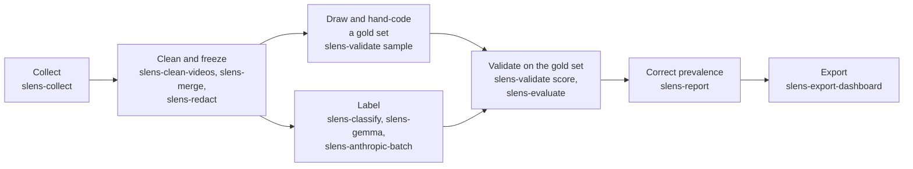

# sentiment-lens

`sentiment-lens` labels public comments about extreme wealth. It was built for the Extreme Wealth Line
project, which studies YouTube comments under four news stories: private jets (`jets`), the
killing of a health-insurance executive (`luigi`), Elon Musk's purchase of Twitter (`musk`)
and ProPublica's reporting on billionaires' tax (`propublica`).

For each comment it records two things:

- **Harm domain.** One or two of `democracy`, `economics`, `environment` and `social`, or
  `unclassified` when the comment engages none of them. A reply the model gives that cannot be
  read is a separate label, `parse_failure`, not `unclassified`.
- **Stance toward extreme wealth.** `negative`, `neutral` or `positive`, or `irrelevant` (no
  stance to rate) or `uncodeable` (the stance cannot be judged).

The labels come from a model: a cloud LLM, a local model or a keyword list. The package then
checks those labels against comments that people coded by hand (the gold set), corrects the
headline shares for the model's errors, and exports the results for a dashboard.

## Who it is for

- Researchers who want to repeat or extend the Extreme Wealth Line analysis.
- Anyone who needs a worked, tested route from "a model labelled these comments" to "this is
  the share, with an honest interval".

You need to be comfortable with the command line and with CSV files. You do not need to write
Python unless you want to add a model backend.

## The pipeline

Each stage reads a CSV and writes a CSV. Labelling runs also write a run record
(`<output>.run.json`) that says exactly how the labels were produced. See
[The pipeline](pipeline.md) for the files and columns at each step.

## What it does not do

- **It measures a conversation, not a population.** People who comment on YouTube videos are
  not a sample of the public. A share of comments is a share of comments.
- **Labels are not results until they are validated.** A model can be stable and still wrong.
  Score every labelling run against a hand-coded gold set before you quote a figure from it
  (see [Validation](validation.md)).
- **It does not decide the instrument for you.** The prompt wording, the worked examples and
  the model are choices. The package makes each one a recorded setting, so two runs can be
  compared, but it cannot tell you which setting is right.
- **It does not publish comment text.** Comment data stays on your machine, except that a
  cloud judge (Anthropic, OpenAI, Google) sends each comment to that provider. See
  [Data protection](data-protection.md) before you collect or label anything.

## Where to start

1. [Install the package](installation.md).
2. Run the [quickstart](quickstart.md). It needs no API key and no network.
3. Read [Data protection](data-protection.md) before you work with real comments.
4. For a real run, follow [Full run, in order](full-run.md).
